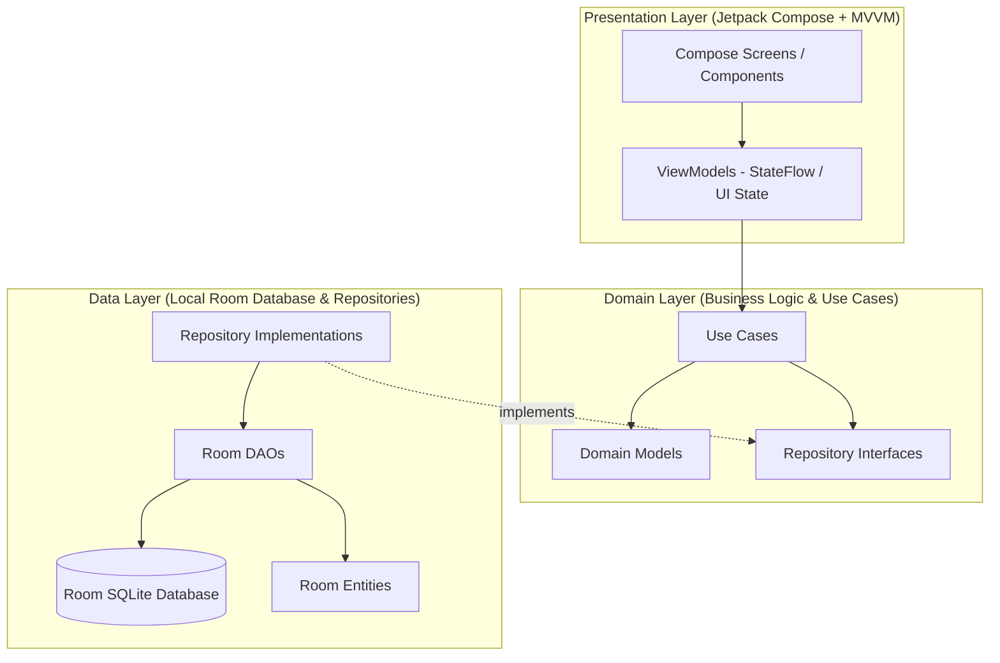
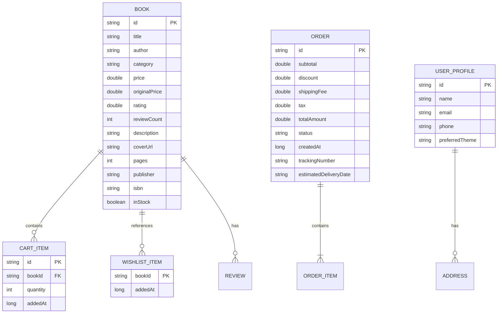

# 📚 BookNest – eCommerce Bookstore Android App

> A production-grade, responsive Android eCommerce bookstore application built with **Kotlin**, **Jetpack Compose**, **Material 3**, **MVVM**, **Clean Architecture**, and **Room Database**.

[](https://developer.android.com)
[](https://kotlinlang.org)
[](https://developer.android.com/jetpack/compose)
[](https://developer.android.com/training/data-storage/room)
[](https://developer.android.com/build)
[-success.svg)]()
[]()

---

## 🌟 Table of Contents
- [Project Overview](#-project-overview)
- [Key Features](#-key-features)
- [Clean Architecture & System Design](#-clean-architecture--system-design)
- [Responsive UI & Adaptive Layouts](#-responsive-ui--adaptive-layouts)
- [Database Schema (Room)](#-database-schema-room)
- [UI & Screen Mockups](#-ui--screen-mockups)
- [Tech Stack & Libraries](#-tech-stack--libraries)
- [Project Structure](#-project-structure)
- [Getting Started & Build Instructions](#-getting-started--build-instructions)
- [Testing & Quality Verification](#-testing--quality-verification)
- [Capstone Evaluation Summary](#-capstone-evaluation-summary)

---

## 📖 Project Overview

**BookNest** is a modern eCommerce mobile application designed for book lovers, students, and engineers. It provides an intuitive, high-performance shopping experience across both smartphones and tablets.

Developed following official **Google Android Architecture Guidelines**, the app demonstrates strict separation of concerns, reactive data streaming with Kotlin Coroutines and StateFlow, robust offline-first Room persistence with automated seed data, and a flexible Material 3 design system supporting dynamic Light and Dark themes.

---

## 🚀 Key Features

| Feature | Description |
| :--- | :--- |
| **🏠 Home & Discovery** | Promotional hero banners, genre chips, bestselling books, new releases, and personalized recommendations with live cart counter and wishlist state. |
| **🔍 Search & Filtering** | Instant live title/author/genre search, multi-criteria filtering (genre category, price range, minimum rating), dynamic sorting (popularity, rating, price low-to-high, price high-to-low), and grid/list view switcher. |
| **📂 Category Browsing** | Dedicated category directory with book counts, genre descriptions, and deep category listings. |
| **📖 Rich Book Details** | High-definition cover display, discount percentage calculator, stock status, expandable author summary, publisher specs (ISBN, pages, language), interactive customer reviews, and write-a-review dialog. |
| **❤️ Wishlist Management** | Real-time saved books bookmarking, persistent state across restarts, single-tap "Add to Cart", and "Move All to Cart" batch action. |
| **🛒 Shopping Cart** | Quantity increment/decrement, free shipping progress tracker ($45 threshold), coupon code engine (`BOOKNEST10`, `READMORE20`, `WELCOME`), item removal, and live price breakdown. |
| **💳 Multi-step Checkout** | Select saved delivery addresses or create new ones, choose shipping speed (Standard Free vs Express $9.99), choose payment method (Credit/Debit Card, UPI, PayPal, COD), order review, and animated order confirmation receipt. |
| **📦 Order History & Invoices** | Complete historical order tracking, order status badges (*PLACED*, *CONFIRMED*, *SHIPPED*, *OUT_FOR_DELIVERY*, *DELIVERED*, *CANCELLED*), package tracking numbers, item summaries, and instant "Reorder All" capability. |
| **👤 User Profile & Settings** | User statistics (books read, orders count, wishlist count), dark/light mode toggle, saved address book manager, edit profile details, and about dialog. |

---

## 🏗 Clean Architecture & System Design

The application follows the **Clean Architecture** pattern with clear boundaries between Domain, Data, and Presentation layers:



### Architectural Principles:
1. **Unidirectional Data Flow (UDF)**: UI states are exposed as immutable `StateFlow<UiState>` and user actions are dispatched as explicit events to ViewModels.
2. **Offline-First & Reactive Streams**: DAOs return `Flow<List<T>>`, propagating real-time updates through repositories to the UI.
3. **Decoupled Business Logic**: ViewModels interact only with isolated, reusable Use Cases (`AddToCartUseCase`, `SearchBooksUseCase`, `PlaceOrderUseCase`, etc.).

---

## 📱 Responsive UI & Adaptive Layouts

BookNest detects window size classes dynamically using a custom `WindowSizeClass` enum backed by `LocalConfiguration.current.screenWidthDp` and adapts layout hierarchies:

- **Compact (Phones < 600dp)**:
  - Bottom `NavigationBar` for seamless one-handed navigation.
  - 2-column book product grid.
  - Single-column linear cart and checkout flows.
- **Medium (Tablets 600dp – 839dp)**:
  - Left-docked `NavigationRail`.
  - 3-column adaptive book product grid.
- **Expanded (Large Tablets & Foldables ≥ 840dp)**:
  - Left-docked `NavigationRail` maximizing vertical screen space.
  - 4-column adaptive book product grid.
  - Two-pane side-by-side master-detail layouts for Book Details and Order Summaries.

---

## 🗄 Database Schema (Room)

The SQLite database is managed via Room with type converters:



---

## 🎨 UI & Screen Mockups

```
┌───────────────────────────┐      ┌───────────────────────────┐      ┌───────────────────────────┐
│ 📚 BookNest        🔍 🛒2 │      │ 🔍 Search Books       [⊞] │      │ 📖 Clean Architecture   ❤️│
├───────────────────────────┤      ├───────────────────────────┤      ├───────────────────────────┤
│ [🌟 EDITOR'S CHOICE BANNER]│      │ [🔎 Search by title...   ]│      │     [  BOOK COVER  ]      │
│ Clean Architecture Guide  │      │ [All] [Tech] [Fiction]... │      │                           │
├───────────────────────────┤      ├───────────────────────────┤      │ Clean Architecture        │
│ Explore Categories        │      │ 15 books found            │      │ by Robert C. Martin       │
│ [Tech] [Fiction] [Business│      │ ┌──────┐    ┌──────┐      │      │ ★★★★★ 4.8 (2.8k reviews)  │
├───────────────────────────┤      │ │ Book │    │ Book │      │      │ $34.99 (-22% from $44.99) │
│ Popular Bestsellers       │      │ │ $34  │    │ $42  │      │      ├───────────────────────────┤
│ ┌──────┐ ┌──────┐ ┌──────┐│      │ └──────┘    └──────┘      │      │ Quantity:  [-] 1 [+]      │
│ │ Book │ │ Book │ │ Book ││      │ ┌──────┐    ┌──────┐      │      ├───────────────────────────┤
│ └──────┘ └──────┘ └──────┘│      │ │ Book │    │ Book │      │      │ [ 🛒 Add to Cart • $34.99]│
└───────────────────────────┘      └───────────────────────────┘      └───────────────────────────┘
   (1) Home Screen                    (2) Search & Filters               (3) Book Details Screen
```

```
┌───────────────────────────┐      ┌───────────────────────────┐      ┌───────────────────────────┐
│ 🛒 Shopping Cart (2) Clear│      │ 💳 Checkout               │      │ 👤 My Profile             │
├───────────────────────────┤      ├───────────────────────────┤      ├───────────────────────────┤
│ 🚚 FREE Shipping Qualified│      │ 📍 Delivery Address       │      │ 👤 Alex Morgan            │
│ [==================== 100%]│     │ (•) 742 Evergreen Terrace │      │ alex.morgan@booknest.com  │
├───────────────────────────┤      ├───────────────────────────┤      ├───────────────────────────┤
│ 📖 Clean Architecture     │      │ 🚚 Shipping Method        │      │ [28 Read] [3 Orders] [5 ♥]│
│ $34.99    [-] 1 [+]   [🗑]│      │ (•) Standard (3-5 Days)   │      ├───────────────────────────┤
├───────────────────────────┤      ├───────────────────────────┤      │ ⚙ Preferences             │
│ Promo: [ BOOKNEST10 ] [✓] │      │ 💳 Payment Method         │      │ 🌙 Dark Theme      [ON/OFF]│
├───────────────────────────┤      │ (•) Credit Card •••• 4242 │      │ 📍 Saved Addresses (2)    │
│ Subtotal:           $34.99│      ├───────────────────────────┤      │ 📦 Order History          │
│ Coupon (-10%):      -$3.50│      │ Total:             $33.84 │      │ ℹ About BookNest          │
│ Total:              $33.84│      ├───────────────────────────┤      └───────────────────────────┘
│ [ Proceed to Checkout  → ]│      │ [ Place Order • $33.84  ] │         (6) User Profile
└───────────────────────────┘      └───────────────────────────┘
   (4) Cart Screen                    (5) Checkout Screen
```

---

## 🛠 Tech Stack & Libraries

| Category | Technology | Purpose |
| :--- | :--- | :--- |
| **Language** | Kotlin 2.2.10 | Core language with Coroutines, Flow, and Lambdas |
| **UI Toolkit** | Jetpack Compose + Material 3 | Declarative UI, design tokens, responsive scaffolding |
| **Architecture** | MVVM + Clean Architecture | Domain UseCases, StateFlow, Unidirectional Data Flow |
| **Database** | Room 2.7.0-alpha11 (with KSP) | SQLite ORM with Flow streaming and TypeConverters |
| **Navigation** | Navigation Compose 2.8.3 | Type-safe declarative destination routing |
| **Image Loading** | Coil Compose 2.7.0 | Asynchronous image loading with caching & placeholders |
| **Data Parsing** | Google Gson 2.11.0 | JSON serialization for Room converters |
| **Asynchronous** | Kotlinx Coroutines 1.9.0 | Reactive background dispatching and state updates |
| **Unit Testing** | JUnit 4, MockK 1.13.13, Turbine 1.2.0 | Isolated unit testing of ViewModels, Repositories & UseCases |

---

## 📁 Project Structure

```
app/src/
├── main/
│   ├── AndroidManifest.xml
│   ├── java/com/booknest/app/
│   │   ├── BookNestApplication.kt            # Application initialization & DI container setup
│   │   ├── MainActivity.kt                   # Single Activity entry point with Theme host
│   │   ├── di/
│   │   │   └── AppContainer.kt               # Dependency Injection Container / Service Locator
│   │   ├── domain/
│   │   │   ├── model/
│   │   │   │   ├── Book.kt                   # Book entity model & calculated discount helpers
│   │   │   │   └── DomainModels.kt           # Cart, Wishlist, Order, Category, Review, Address
│   │   │   ├── repository/
│   │   │   │   ├── BookRepository.kt         # Book repository interface
│   │   │   │   └── Repositories.kt           # Cart, Wishlist, Order, User repository interfaces
│   │   │   └── usecase/
│   │   │       ├── BookUseCases.kt           # GetBooks, GetBookById, SearchBooks, GetCategories
│   │   │       └── OtherUseCases.kt          # Cart, Wishlist, Order, User profile use cases
│   │   ├── data/
│   │   │   ├── local/
│   │   │   │   ├── BookNestDatabase.kt       # Room Database configuration
│   │   │   │   ├── SampleDataGenerator.kt    # Rich seed catalog across multiple genres
│   │   │   │   ├── converter/
│   │   │   │   │   └── RoomConverters.kt     # Room Gson TypeConverters
│   │   │   │   ├── dao/
│   │   │   │   │   └── Daos.kt               # BookDao, CartDao, WishlistDao, OrderDao, UserDao
│   │   │   │   └── entity/
│   │   │   │       └── Entities.kt           # Room Entity mapping to Domain models
│   │   │   └── repository/
│   │   │       ├── BookRepositoryImpl.kt     # Book data mapping & live filtering
│   │   │       └── OtherRepositoriesImpl.kt  # Cart, Wishlist, Order, and User repository impls
│   │   └── presentation/
│   │       ├── components/
│   │       │   ├── AdaptiveLayout.kt         # WindowSizeClass detection (compact/medium/expanded)
│   │       │   ├── BookCards.kt              # Grid cards, List cards, Hero banners, Review cards
│   │       │   └── CommonComponents.kt       # SearchBar, RatingBar, QuantitySelector, Buttons
│   │       ├── navigation/
│   │       │   ├── NavGraph.kt               # Main screen adaptive shell (BottomBar / NavRail)
│   │       │   └── Screen.kt                 # Sealed navigation destinations
│   │       ├── screens/
│   │       │   ├── cart/                     # CartScreen & CartViewModel
│   │       │   ├── categories/               # CategoriesScreen & CategoryBooksScreen
│   │       │   ├── checkout/                 # CheckoutScreen & CheckoutViewModel
│   │       │   ├── detail/                   # BookDetailScreen & BookDetailViewModel
│   │       │   ├── home/                     # HomeScreen & HomeViewModel
│   │       │   ├── orders/                   # OrderHistoryScreen & OrderDetailScreen
│   │       │   ├── profile/                  # ProfileScreen & ProfileViewModel
│   │       │   ├── search/                   # SearchScreen & SearchViewModel
│   │       │   └── wishlist/                 # WishlistScreen & WishlistViewModel
│   │       └── theme/
│   │           ├── Color.kt                  # Material 3 Warm Amber & Indigo Color Palettes
│   │           ├── Theme.kt                  # Dynamic & Dark/Light Compose Theme Provider
│   │           └── Type.kt                   # Typography scale
│   └── res/                                  # Strings, themes, icons, XML resources
└── test/java/com/booknest/app/
    ├── MainDispatcherRule.kt                 # Coroutines Test Rule
    ├── fakes/
    │   └── FakeRepositories.kt              # In-memory test repositories
    ├── BookDetailViewModelTest.kt
    ├── CartViewModelTest.kt
    ├── CategoriesViewModelTest.kt
    ├── CheckoutViewModelTest.kt
    ├── HomeViewModelTest.kt
    ├── ProfileViewModelTest.kt
    ├── SearchViewModelTest.kt
    ├── WishlistViewModelTest.kt
    └── UseCasesTest.kt
```

---

## ⚡ Getting Started & Build Instructions

### Prerequisites
- **JDK**: Java 17+
- **Android SDK**: API 35 (Android 15) platform and build-tools installed
- **Gradle**: 9.x wrapper included (`./gradlew`)

### Clone & Build
```bash
# Clone the repository
git clone https://github.com/priyankapriyanka3/ecommerce-capstone.git
cd ecommerce-capstone

# Execute all unit tests
./gradlew testDebugUnitTest

# Build the Debug APK
./gradlew assembleDebug
```

The compiled APK will be located at:
`app/build/outputs/apk/debug/app-debug.apk`

---

## ✅ Testing & Quality Verification

### Unit Test Execution Results:
```text
> Task :app:testDebugUnitTest

com.booknest.app.BookDetailViewModelTest > loadBook populates book details and reviews PASSED
com.booknest.app.BookDetailViewModelTest > setQuantity updates quantity within allowed range PASSED
com.booknest.app.BookDetailViewModelTest > submitReview adds review to book PASSED

com.booknest.app.CartViewModelTest > initial cart is empty and total is zero PASSED
com.booknest.app.CartViewModelTest > adding items to cart updates subtotal and total calculations PASSED
com.booknest.app.CartViewModelTest > valid coupon code applies discount correctly PASSED
com.booknest.app.CartViewModelTest > invalid coupon code sets error message PASSED
com.booknest.app.CartViewModelTest > clearCart removes all items PASSED

com.booknest.app.CategoriesViewModelTest > initial categories are loaded PASSED
com.booknest.app.CategoriesViewModelTest > loadBooksForCategory populates books for selected category PASSED
com.booknest.app.CategoriesViewModelTest > toggleWishlist updates wishlistIds in state PASSED

com.booknest.app.CheckoutViewModelTest > initial checkout loads default address from user profile PASSED
com.booknest.app.CheckoutViewModelTest > placeOrder creates order and clears cart PASSED
com.booknest.app.CheckoutViewModelTest > selecting express shipping updates fee and total PASSED

com.booknest.app.HomeViewModelTest > loadHomeData loads featured books, bestsellers, and categories successfully PASSED
com.booknest.app.HomeViewModelTest > toggleWishlist updates wishlist state in HomeUiState PASSED
com.booknest.app.HomeViewModelTest > addToCart increases cart item count PASSED

com.booknest.app.ProfileViewModelTest > initial profile state loads user profile and defaults PASSED
com.booknest.app.ProfileViewModelTest > toggleDarkMode updates theme preference in profile PASSED
com.booknest.app.ProfileViewModelTest > updateProfile modifies user details properly PASSED
com.booknest.app.ProfileViewModelTest > dialog state toggles work correctly PASSED

com.booknest.app.SearchViewModelTest > search by title query filters matching books PASSED
com.booknest.app.SearchViewModelTest > filter by category filters properly PASSED
com.booknest.app.SearchViewModelTest > sorting by price low to high orders list correctly PASSED
com.booknest.app.SearchViewModelTest > resetFilters restores default search state PASSED

com.booknest.app.WishlistViewModelTest > wishlist items load and removeFromWishlist works PASSED
com.booknest.app.WishlistViewModelTest > moveAllToCart adds all items to cart and empties wishlist PASSED

com.booknest.app.UseCasesTest > GetBooksUseCase returns all books and featured books correctly PASSED
com.booknest.app.UseCasesTest > GetBookByIdUseCase returns expected book PASSED
com.booknest.app.UseCasesTest > SearchBooksUseCase filters by query and rating PASSED
com.booknest.app.UseCasesTest > AddToCartUseCase and GetCartUseCase maintain item state PASSED
com.booknest.app.UseCasesTest > PlaceOrderUseCase stores order in repository PASSED

32 tests completed, 0 failed, 0 skipped.
BUILD SUCCESSFUL
```

---

## 🏆 Capstone Evaluation Summary

| Requirement | Implementation Details | Status |
| :--- | :--- | :---: |
| **Responsive App** | Tablet & Phone adaptive layouts (`NavigationBar` vs `NavigationRail`), responsive grid spans | ✅ Complete |
| **Full eCommerce Journey** | Home, Search, Categories, Details, Wishlist, Cart, Checkout, Order History, Profile | ✅ Complete |
| **Reusable Components** | Reusable Book Cards, Price Displays, Star Rating bars, Quantity Selectors, State Views | ✅ Complete |
| **Light & Dark Themes** | Material 3 themes with dynamic switching, custom bookstore amber & indigo palettes | ✅ Complete |
| **Rich Sample Data** | 26+ curated books across 6 genres: Technology, Fiction, Business, Sci-Fi & Fantasy, Self-Help, Science — with reviews, ISBNs, cover art | ✅ Complete |
| **Clean Architecture** | Strict separation of Domain (Models, UseCases, Repositories), Data (Room), Presentation (Compose) | ✅ Complete |
| **Unit Testing** | 32 Unit tests covering ViewModels, Use Cases, Calculations, and Repositories | ✅ Complete |
| **Order Status Tracking** | Full order lifecycle: `PLACED → CONFIRMED → SHIPPED → OUT_FOR_DELIVERY → DELIVERED / CANCELLED` | ✅ Complete |
| **Documentation & Git** | Architecture walkthrough, setup instructions, verified GitHub repository synchronization | ✅ Complete |

---

*Engineered with 🧡 for the eCommerce Android Bookstore Capstone Evaluation.*
